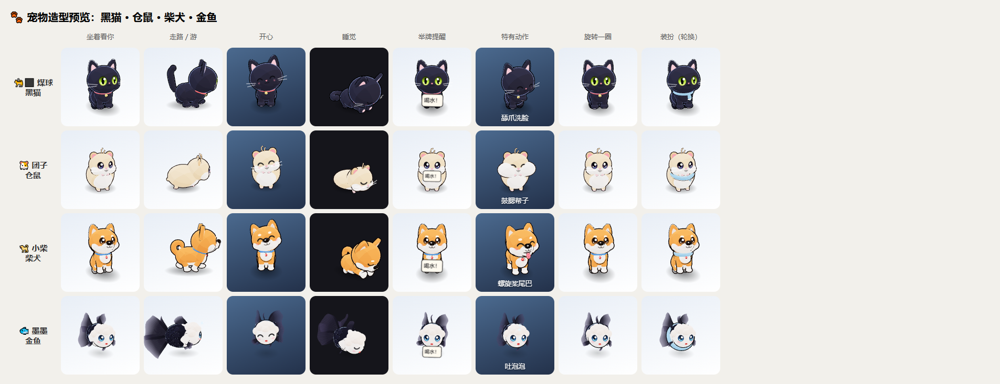

# 🐾 煤球 · 桌面喝水宠物

住在 Windows 桌面上的 3D 小宠物：会在屏幕上溜达、跳到窗口上巡视、躲在窗口后面偷看你在干嘛，到点就用各种方式提醒你喝水。



## 功能

- **四种宠物**：🐈‍⬛ 黑猫煤球、🐹 仓鼠团子、🐕 柴犬小柴、🐟 金鱼墨墨（在桌面上空游），每种都有特有动作、自己的叫声和一整套语音
- **换肤**：每种宠物 4 套外观（黑猫 / 橘猫 / 白猫 / 英短蓝猫，奶黄 / 银狐 / 紫仓 / 布丁，赤柴 / 黑柴 / 白柴 / 胡麻柴，熊猫狮头 / 鹤顶红 / 红狮头 / 蓝狮头），右键菜单就能换宠物、换肤
- **喝水提醒**：看你在做什么换提醒方式（打字时等你停下、聊天时举牌、开会看视频时不出声），不理它会升级（敲窗 → 坐到你的窗口上 → 推杯子）；跟着上下班时间、午休、工作日走
- **定时提醒**：固定时间 / 跟着下班时间 / 时间段内重复，可以选星期几
- **和窗口互动**：躲在窗口后面时，窗口拖开多少宠物就露出多少；窗口拖到它身上会躲下；站在窗口上被拖会坐车、被甩下来；盯着你拖动的窗口看
- **互动**：摸摸、抱抱、逗猫棒、拎起来、吓一跳；心情和亲密度会变化；喝水达标解锁装扮
- **喝水统计**：今天、最近 7 天、按小时分布、提醒回应情况
- 支持任意分辨率、缩放比和多屏幕；数据只保存在本机，不联网

## 技术栈

- [Tauri 2](https://tauri.app/)（Rust）：透明置顶窗口、读取桌面窗口布局、托盘、提醒调度、SQLite 本地数据
- Vue 3 + TypeScript + Vite：宠物大脑、设置和统计页面
- [Three.js](https://threejs.org/)：全部模型由代码搭建（卡通着色 + 描边），没有外部模型文件

## 开发

需要：Windows 10 / 11、[Node.js](https://nodejs.org/) 20+、[pnpm](https://pnpm.io/)、[Rust](https://www.rust-lang.org/)（stable）、WebView2（Windows 11 自带）。

```bash
pnpm install
pnpm tauri dev        # 开发模式运行（前端改动会热更新）
pnpm typecheck        # 前端类型检查
node tools/validate-actions.mjs   # 检查动作库配置有没有写错
```

开发时可以在浏览器里打开这些页面（`pnpm dev` 之后）：

| 页面 | 用途 |
|---|---|
| `http://localhost:1420/species-preview.html` | 四种宠物 × 各种姿势的造型预览；加 `?skins=1` 看所有皮肤 |
| `http://localhost:1420/simulate.html` | 行为模拟测试：快速跑几小时模拟时间，检查动作、窗口互动、各种提醒是否正常；加 `?species=shiba` 测别的宠物 |

## 打包

```bash
pnpm tauri build
```

产物：

- 免安装版：`src-tauri/target/release/meiqiu-water-pet.exe`
- 安装包：`src-tauri/target/release/bundle/nsis/MeiqiuWaterPet_<版本>_x64-setup.exe`

## 目录结构

```
src/
  pet/                宠物窗口
    PetController.ts    控制器：桌面布局、鼠标、提醒、设置、菜单
    CatBrain.ts         宠物大脑：动作执行器 + 各种能力（走路、跳跃、偷看、提醒、捣乱、窗口互动……）
    actionSystem.ts     动作系统：按条件和权重挑选动作
    WindowMotionTracker.ts  窗口动态跟踪（拖动、甩、弹出、关闭）
    species.ts / skins.ts   宠物种类、皮肤登记表
    BlackCatModel.ts / models/   3D 模型
    catVoice.ts / speciesSounds.ts   语音和叫声
  settings/           设置窗口
  statistics/         喝水统计窗口
  preview/            造型预览、行为模拟测试（只在开发时用）
src-tauri/src/        Rust 后端：窗口、桌面布局、鼠标、提醒调度、设置、心情、数据库、托盘
public/config/        动作库（cat-actions.json）和台词、提醒等配置
public/voice/         预生成的语音（每种宠物一个目录）
tools/                动作库检查、语音生成脚本
docs/                 功能设计、动作系统说明
```

## 自定义

- **动作库**：`public/config/cat-actions.json`，说明见 [docs/动作系统说明.md](docs/动作系统说明.md)。用户也可以在 `%APPDATA%\com.meiqiu.waterpet\config\` 放同名文件覆盖或追加动作
- **加皮肤**：在 `src/pet/skins.ts` 里加一条
- **加宠物**：在 `src/pet/species.ts` 登记，`src/pet/models/` 下写一个实现 `PetModel` 接口的模型并在 `speciesModels.ts` 登记，再在动作库里加它的特有动作

## 语音

`public/voice/` 里的语音是用语音合成预先生成的。重新生成需要语音合成接口，密钥只通过环境变量传入，不写进代码：

```bash
cd tools/voice-generator
node make-species-lines.mjs   # 由猫的台词生成其它宠物的台词清单
SPARKLIGHT_TTS_API_KEY=... SPARKLIGHT_BIZLINE_ID=... SPARKLIGHT_APP_ID=... \
  node generate-voice-lines.mjs --lines=voice-lines.shiba.json --output=../../public/voice/shiba
```

## 隐私

煤球会读取窗口标题、程序名和窗口位置，只用来判断你在做什么、换个方式提醒你，以及和窗口互动；不读取窗口内容，不记录按键（只判断是否在打字）。所有数据保存在本机 `%APPDATA%\com.meiqiu.waterpet\`，不联网、不上传。
